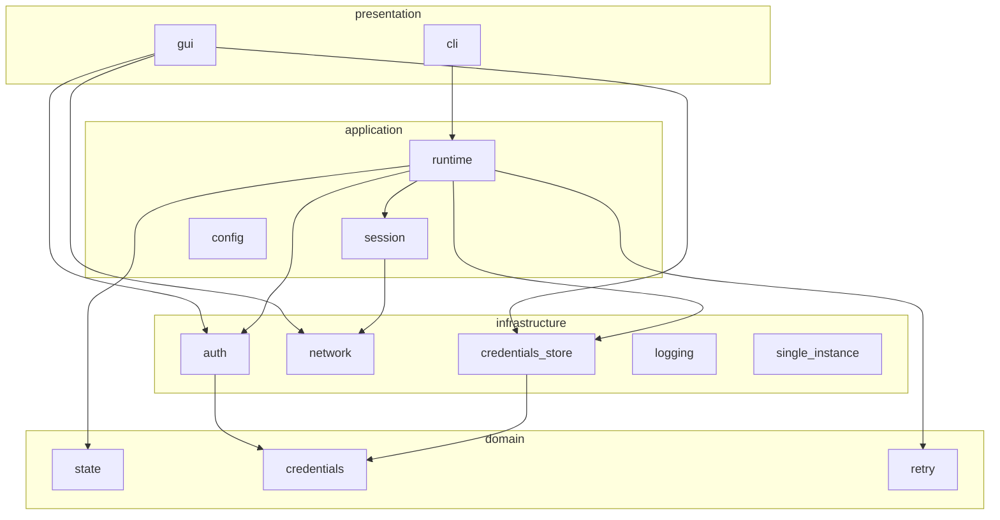

# DormNet Architecture

## Goals

Background Windows app that detects dorm captive portals, authenticates when required, monitors the session, and recovers from transient failures — with low resource use and no secret leakage.

## Layered layout

Single crate `dormnet` (install paths unchanged: `%LOCALAPPDATA%\DormNet`).

```text
src/
  domain/           # pure types — no I/O
    state.rs
    credentials.rs  # Credentials value object
    retry.rs
  application/      # orchestration
    config.rs       # AppConfig
    runtime.rs      # state machine loop
    session.rs      # AuthGate + SessionMonitor
  infrastructure/   # adapters
    auth/           # AuthProvider + MikroTik
    network.rs
    credentials_store.rs  # Windows Credential Manager
    logging.rs
    single_instance.rs
  presentation/     # user-facing
    cli.rs
    gui.rs
  main.rs           # thin → presentation::cli::run()
  lib.rs            # layers + compat re-exports
```



## Where to change what

| Change | Layer / module |
|--------|----------------|
| Connectivity probes / captive heuristics | `infrastructure/network` |
| Login form / MikroTik URLs | `infrastructure/auth` |
| Backoff / failure kinds | `domain/retry` |
| State machine transitions | `application/runtime` + `domain/state` |
| Keyring load/store | `infrastructure/credentials_store` |
| CLI flags / subcommands | `presentation/cli` |
| egui screens | `presentation/gui` |

## Compatibility re-exports

`lib.rs` still exposes `dormnet::auth`, `dormnet::network`, `dormnet::creds`, `dormnet::Runtime`, `dormnet::AppConfig`, `dormnet::session`, `dormnet::retry` for tests and older callers. Prefer new paths internally (`dormnet::infrastructure::auth`, etc.).

## Connectivity probes

| Probe | Expected when online |
|-------|----------------------|
| `http://www.msftconnecttest.com/connecttest.txt` | Body contains `Microsoft Connect Test` |
| `http://connectivitycheck.gstatic.com/generate_204` | HTTP 204 |

Captive / blocked signals (heuristic, not every redirect):

- Unexpected HTML body on the Microsoft test URL
- Non-204 / redirect landing on a non-probe host for `generate_204`
- Timeout / DNS failure treated as transient network errors

## State machine

```
Starting
  -> WaitingForNetwork
  -> CheckingInternet
       -> MonitoringSession          (internet OK)
       -> DetectingCaptivePortal     (captive or blocked)
            -> AuthenticationRequired
                 -> Authenticating
                      -> MonitoringSession       (auth OK)
                      -> AuthenticationFailed    (bad credentials; stop retry storm)
                      -> RetryWaiting            (transient)
            -> RetryWaiting                      (transient detect errors)
  MonitoringSession -> DetectingCaptivePortal    (session lost)
  RetryWaiting -> CheckingInternet
```

Rules:

- Only one authentication attempt at a time.
- Bad credentials do not use the transient retry loop.
- Shutdown (Ctrl+C / process exit) leaves the machine cleanly from any state.
- Success after auth is confirmed by re-running connectivity probes, not by HTTP 200 alone.
- When already Online at boot and credentials exist, runtime still enters EnsureSession (auto-login after reboot).

## Startup model

- Release binary uses `windows_subsystem = "windows"` (no console window).
- Auto-start via Startup folder / Task Scheduler for the interactive user (`scripts/install.ps1`).
- Not a Windows Service in Phase 1.
- Credential access requires the user session (logon trigger).

## Testing strategy

- Unit/integration tests use an in-process mock portal (`wiremock` / local HTTP).
- Tests must never send credentials to the real dorm network.
- Dorm-specific auth is documented in `docs/login-analysis.md`.
